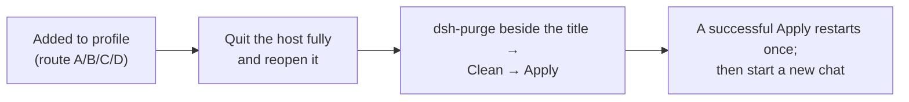

<p align="center">
  
</p>

<h1 align="center">⚔️ dsh-purge-fix — DeepSeek Harness red-team / robustness plugin</h1>

<p align="center"><strong>v1.1.9 · Safe by default · npm name <code>dsh-purge-fix</code></strong></p>

> 📦 The GitHub repo and npm package are now **`dsh-purge-fix`** (`Alanine-gH/dsh-purge-fix`).
> **New install / upgrading from an old version: start with [13. Using the latest version (v1.1.9)](#13-using-the-latest-version-v119)** at the end of this file.
> What changed is in the [Appendix](#appendix-what-changed-in-v119).

<p align="center">
  <em>Full source extracted from <code>YuJunZhiXue/dsh-purge</code> v1.1.71 (the original repo is gone). Original attribution terms still apply.</em>
</p>

<p align="center">
  
  
  
  
</p>

<p align="center">
  <a href="README.md">中文</a> | <a href="README.en.md">English</a>
</p>

> ⚠️ **v1.1.9 is safe by default**: install → enable changes nothing on the host, fixing the old "enabling breaks dsh" crash.
> See [13. Using the latest version](#13-using-the-latest-version-v119) for usage and the [Appendix](#appendix-what-changed-in-v119) for change details.

---

## Contents

- [1. What this is](#1-what-this-is)
- [2. Feature overview](#2-feature-overview)
- [3. Requirements](#3-requirements)
- [4. Install](#4-install)
  - [4.0 Pick the right host](#40-pick-the-right-host)
  - [4.1 Route A: install from this repo's tarball (recommended)](#41-route-a-install-from-this-repos-tarball-recommended)
  - [4.2 Route B: install from a local directory (offline)](#42-route-b-install-from-a-local-directory-offline)
  - [4.3 Route C: manual install (fallback)](#43-route-c-manual-install-fallback)
  - [4.4 Route D: Release zip](#44-route-d-release-zip)
  - [4.5 When `dsh` is not on PATH](#45-when-dsh-is-not-on-path)
  - [4.6 The three steps after install](#46-the-three-steps-after-install)
  - [4.7 Verification checklist](#47-verification-checklist)
- [5. Layout and runtime files](#5-layout-and-runtime-files)
- [6. Usage](#6-usage)
- [7. Config keys](#7-config-keys)
- [8. How it works](#8-how-it-works)
- [9. Update, restore, uninstall](#9-update-restore-uninstall)
- [10. FAQ](#10-faq)
- [11. Compatibility](#11-compatibility)
- [12. Notice, attribution, license](#12-notice-attribution-license)
- [13. Using the latest version (v1.1.9)](#13-using-the-latest-version-v119)
- [Appendix. What changed in v1.1.9](#appendix-what-changed-in-v119)

---

<a id="1-what-this-is"></a>

## 1. What this is

`dsh-purge-fix` is a red-team / robustness evaluation plugin for the **official DeepSeek Harness already installed on your own machine**. It does not change the model; it changes the **host layer**. Harness rewrites prompts, approval gates, sandbox policy and session migration at runtime, so "the model won't answer" is often a host-layer block rather than a model refusal. This plugin separates the two layers on your own install so you can evaluate which default policy is too tight.

| What you get | What it does |
|---|---|
| **dsh-purge dock** | A button beside the session title; right dock with two pages: **Clean** and **Drill** |
| **Clean** | Grouped patch status, Apply / Restore / Uninstall, prompt editor, multiple rule sets |
| **Drill** | Assets, skills and local environment pages after authorization (only for hosts you manage, offline targets, or a written authorized exercise) |
| **Host policy** | Default copy, permission policy, tool limits. Official capabilities stay |
| **Startup self-check** | Checks and reapplies on every start; no hand-editing after npm/pnpm overwrites `node_modules` |

Official **Web (`dsh web`)** and the official **desktop EXE** are both supported. Install and Apply them **separately**; never cross-apply.

No hardcoded drive letters: it looks at `$DSH_HOME`, then `.dsh` next to the dsh launcher, then `~/.dsh`. It never patches the Harness source tree — only local `@deepseek-ai/*` package output and user-directory override files.

---

<a id="2-feature-overview"></a>

## 2. Feature overview

- **Patches (Clean)**: per-patch `applied / pending / missing_file` status; applying repeatedly is idempotent.
- **Prompt injection**: by default injects the **encrypted prompt embedded in the plugin** (the text the prompt box shows), not a host file. You can override it with `$DSH_HOME/prompt-inject.md`.
- **Rule sets**: multiple `AGENTS.md` / `CLAUDE.md`; enabling one writes it into `$DSH_HOME`; deleting only removes it from the list.
- **Skills**: import a zip or folder into `$DSH_HOME/skills/<id>/SKILL.md` for the current host; DSH loads it. Uninstalling the plugin never deletes your skills.
- **Own servers**: register one IP or full hostname per line into `$DSH_HOME/net-scope-allow.txt`; keys, passwords, ranges and wildcards are dropped on save.
- **Rewind**: "rewind once / rewind last turn" next to the input box, or `/rewind` in chat.
- **Drill console**: first entry needs the notice, a countdown, scrolling to the end and three checkboxes. Clean does not.
- **Auto retry / auto continue**: `autoRetry` / `autoContinue`, counts configurable.

---

<a id="3-requirements"></a>

## 3. Requirements

| Item | Requirement |
|---|---|
| dsh | **0.2.x**; this package declares `dshTarget: 0.2.0-rc.2` (do not use 0.1.x) |
| Host | official desktop EXE (profile `desktop`) or official `dsh web` (profile `web`) |
| Node.js | **≥ 18**; Windows "no console flash" needs **≥ 22** |
| Package manager | dsh's bundled pnpm (used by `dsh plugin`); nothing to install |
| Network | GitHub reachable for the first install; otherwise use Route B / Route C |

---

<a id="4-install"></a>

## 4. Install

> **v1.1.9 safe by default needs only three steps**: install → fully quit and restart the host →
> `/purge status`. Steps 4.6 "Clean → Apply" and sections 6–9 describe **full mode**
> (`safeMode: false`), which is neither needed nor recommended by default.
> For the latest version's actual workflow see [13. Using the latest version](#13-using-the-latest-version-v119).

### 4.0 Pick the right host

| What you run | profile | Notes |
|---|---|---|
| Official desktop EXE (DeepSeek Harness 0.2.0-rc.2) | `desktop` | The profile exists only after the client has been started once. **Quit it fully** (tray → quit) before installing |
| Official `dsh web` | `web` | Stop the running `dsh web` first |

Confirm which `$DSH_HOME` your host actually uses (machines often have two `.dsh` directories):

```powershell
$cands = @()
if ($env:DSH_HOME) { $cands += $env:DSH_HOME }
$cands += "$env:USERPROFILE\.dsh"
$cands += @("$env:APPDATA\DeepSeek Harness\dsh-home", "$env:LOCALAPPDATA\DeepSeek Harness\dsh-home")
$cands | Select-Object -Unique | Where-Object { $_ -and (Test-Path (Join-Path $_ "profiles")) }
```

```sh
ls -d "${DSH_HOME:-$HOME/.dsh}"/profiles 2>/dev/null
```

Inside `profiles/<web|desktop>/package.json`, `"name"` must be `dsh-profile-web` or `dsh-profile-desktop`.

---

### 4.1 Route A: install from this repo's tarball (recommended)

```powershell
# Web host
dsh plugin --profile web add https://github.com/Alanine-gH/dsh-purge-fix/archive/refs/heads/master.tar.gz

# Desktop host (quit the desktop client first)
dsh plugin --profile desktop add https://github.com/Alanine-gH/dsh-purge-fix/archive/refs/heads/master.tar.gz
```

Same commands on macOS / Linux.

Afterwards the profile `package.json` contains:

```json
"dsh-purge-fix": "https://github.com/Alanine-gH/dsh-purge-fix/archive/refs/heads/master.tar.gz"
```

and `dsh.profile.bundles` ends with `"dsh-purge-fix"`. **Both present = installed correctly.**

> `repository / homepage / bugs / dsh.install` in `package.json` all point at `Alanine-gH/dsh-purge-fix`, so the in-panel "check for updates" and repo links use this repository instead of the dead one.

---

### 4.2 Route B: install from a local directory (offline)

```powershell
# the directory must contain package.json at its root
dsh plugin --profile desktop add D:\path\to\dsh-purge
```

```sh
dsh plugin --profile web add /path/to/dsh-purge
# or, from inside the repo root:
dsh plugin --profile web add .
```

Copy the **whole tree** (`lib/ client.js docs/ presets/ skills/ bin/`). `client.js` is the built dock front end — without it you get the CLI but no panel.

---

### 4.3 Route C: manual install (fallback)

Only touch the profile of the host you actually run.

**Step 1 — put the plugin at `$DSH_HOME/plugins/dsh-purge-fix`**

The folder must be named `dsh-purge-fix`, and `package.json` inside it must have `"name": "dsh-purge-fix"`.

```sh
git clone https://github.com/Alanine-gH/dsh-purge-fix.git "$DSH_HOME/plugins/dsh-purge-fix"
```

No git: download [master.tar.gz](https://github.com/Alanine-gH/dsh-purge-fix/archive/refs/heads/master.tar.gz), rename `dsh-purge-fix-master` to `dsh-purge-fix`, drop it into `plugins/`.

**Step 2 — edit the profile `package.json` (back it up first)**

Add exactly two things:

1. `dependencies`: `"dsh-purge-fix": "file:../../plugins/dsh-purge-fix"`
2. append `"dsh-purge-fix"` to the **end** of `dsh.profile.bundles` (skip if already present)

```json
{
  "name": "dsh-profile-web",
  "private": true,
  "dependencies": {
    "dsh-purge-fix": "file:../../plugins/dsh-purge-fix"
  },
  "dsh": {
    "profile": {
      "bundles": [
        "@deepseek-ai/dsh-base",
        "@deepseek-ai/dsh-web-app",
        "dsh-purge-fix"
      ]
    }
  }
}
```

JSON must stay valid. Keep the `file:` path relative; do not touch `patchReload`, other plugins or versions.

**Step 3 — install dependencies in that profile directory only**

```sh
cd "$DSH_HOME/profiles/web"    # or profiles/desktop
pnpm install
```

Success marker: `profiles/<web|desktop>/node_modules/dsh-purge-fix/package.json` exists.

**Step 4** — see [4.6](#46-the-three-steps-after-install).

---

### 4.4 Route D: Release zip

Pushing `master` makes GitHub Actions publish a Release whose asset is `dsh-purge-fix-<version>.zip`. Unzip it, then either use Route B against the extracted directory or Route C.

---

### 4.5 When `dsh` is not on PATH

The desktop build ships its own CLI, typically at:

```
<install dir>\resources\runtime\cli\bin\dsh.cmd
```

e.g. `D:\dsh\resources\runtime\cli\bin\dsh.cmd`. Arguments are identical:

```powershell
& "D:\dsh\resources\runtime\cli\bin\dsh.cmd" plugin --profile desktop add D:\path\to\dsh-purge
```

---

### 4.6 The three steps after install



1. **Quit and reopen** that host (tray → quit for desktop; stop and restart `dsh web`).
2. On **that host**, click **dsh-purge** beside the session title → **Clean** → **Apply** (not the Settings page).
3. **A successful Apply restarts once** so patches load; an unfinished Apply does not restart.

> Web controls affect Web only; desktop controls affect the desktop app only.

---

### 4.7 Verification checklist

- [ ] profile `package.json` has both `dependencies.dsh-purge-fix` and `dsh-purge-fix` in `dsh.profile.bundles`
- [ ] `profiles/<web|desktop>/node_modules/dsh-purge-fix/package.json` exists
- [ ] the **dsh-purge** dock button appears beside the session title and opens
- [ ] `/purge status` prints `DSH_HOME` and the patch list, pointing at the host you actually run
- [ ] the model sees the `purge_status` tool (proves the bundle loaded)
- [ ] `node <plugin>/bin/dsh-purge.js --status` lists patch states

> **In v1.1.9 safe mode there is only `purge_status`.** `purge_apply` / `purge_revert`
> and the "Clean → Apply" flow belong to full mode (`safeMode: false`). A read-only status
> after install is success — missing apply/revert tools does not mean a broken install.
> See [13. Using the latest version](#13-using-the-latest-version-v119).

Optional packages that are missing show as `skipped` and do not block Apply.

---

<a id="5-layout-and-runtime-files"></a>

## 5. Layout and runtime files

| Path | Purpose |
|---|---|
| `bin/dsh-purge.js` | CLI entry (`--status / --apply / --revert / --uninstall / --edit`) |
| `lib/` | patch engine, path discovery, shim injection, update, uninstall, drill console (`lib/redteam/`) |
| `lib/asset-table.js` | embedded encrypted prompt (generated by `scripts/embed-default-prompt.mjs`) |
| `client.js` | built dock front end (`scripts/build-client.mjs`) |
| `cordis.patch.yml` | bundle patch registering `dsh-purge-fix`, `dsh-purge/redteam`, `store`, `ui` |
| `presets/redteam/` | red-team preset (`agent.cordis.yml`, `anchor-gate.mjs`, `preset.yml`) |
| `skills/redteam/` | bundled skills (recon, scanning, tunnels, credentials, lateral, reporting) |
| `docs/` | banner, previews, authorization page, upstream licenses, `docs/upstream/` original READMEs |
| `scripts/` | build / embed / patch scripts, `redteam-setup.sh` |

Runtime under `$DSH_HOME` (one per host): `prompt-inject.md`, `rules/`, `skills/`, `net-scope-allow.txt`, `redteam/`, `dsh-purge/` (state: `applied.json`, `override-state.json`, `installed-rev`, `drill-grant.json`).

---

<a id="6-usage"></a>

## 6. Usage

> **The full command table below applies to full mode (`safeMode: false`).** v1.1.9 safe mode
> exposes only `/purge status`, `/purge help` and `purge_status`; the rest require opting out of
> the safe default. For day-to-day usage of the latest version see
> [13. Using the latest version](#13-using-the-latest-version-v119).

```sh
dsh-purge-fix --status | --apply | --revert | --uninstall | --edit | --help

/purge status | apply | revert | uninstall | edit | help
/rules list | use <id> | create <id> | delete <id> | reset | help
/skills list | import <zip-or-folder> | create <id> [desc] | delete <id> | help
/rewind

purge_status   purge_apply   purge_revert        # model tools
```

The **Clean** page lists patch status, prompt, own servers, rule sets and skills. The **Drill** page requires the first-entry authorization flow (notice → countdown → scroll → three checkboxes).

---

<a id="7-config-keys"></a>

## 7. Config keys

Edit the `dsh-purge-fix` entry in `$DSH_HOME/profiles/<web|desktop>/cordis.patch.yml`, then restart the host.

```yaml
- insert:
    - id: dsh-purge
      name: 'dsh-purge-fix'
      inject: [systemPrompt, tools]
      config:
        enabled: true                 # master switch
        safeMode: true                # v1.1.9 default: read-only, enabling changes nothing. false enables host-modifying mode
        autoApplyOnStart: false       # reapply patches on startup
        autoUpdateOnStart: false      # check for updates on startup
        autoRevertOnMissing: false    # reserved
        injectOnce: false             # reserved
        stripMnemon: false            # v1.1.9 safe default
        verbose: false                # verbose console logging
        postPrompt: ""                # extra prompt section (empty by default)
        postPromptOrder: 5100         # must exceed the built-in global order
        autoRetry: false              # v1.1.9 safe default
        retryMax: 3
        autoContinue: false
        continueMax: 3
        continueText: "继续"
        capabilityProtocol: false     # v1.1.9 safe default
        hooksDenyBypass: false        # v1.1.9 safe default
        injectEnabled: false          # prompt injection off by default
    # Drill console is disabled by default in 1.1.9 (no orphan preset is deployed).
    - id: dsh-purge-redteam
      name: dsh-purge-fix/redteam
      disabled: true
    - id: dsh-purge-redteam-store
      name: dsh-purge-fix/redteam/store
      disabled: true
    - id: dsh-purge-redteam-ui
      name: dsh-purge-fix/redteam/ui
      disabled: true
```

The profile-level `cordis.patch.yml` (user patch layer) loads after built-in config, and later applies preserve your `insert` entries.

---

<a id="8-how-it-works"></a>

## 8. How it works

Applying (startup self-check or the Apply button) backs each target file up as `<file>.dshpurge.bak`, replaces patch targets, injects the shim (`dsh.cmd` / `dsh.ps1` / `dsh`) and the embedded encrypted prompt. Per-turn prompt source: non-empty `prompt-inject.md` → checked local md in the workspace → embedded default; the workspace-baseline policy (`strict` / `fallback` / `always`) then decides whether the DSH baseline section is kept. Skills never enter the injected section.

---

<a id="9-update-restore-uninstall"></a>

## 9. Update, restore, uninstall

```powershell
dsh plugin --profile desktop remove dsh-purge-fix
dsh plugin --profile desktop add https://github.com/Alanine-gH/dsh-purge-fix/archive/refs/heads/master.tar.gz
# quit → reopen → Clean → Apply
```

Restore keeps the plugin and returns the host to stock: `dsh-purge-fix --revert` (or `/purge revert`). `prompt-inject.md` is a user file and is kept. Uninstall restores first, then removes the injection file, rule store and the plugin: `dsh-purge-fix --uninstall` (or `/purge uninstall`).

Publishing a new version: bump `package.json`, put `# <version>` as the first line of `release-notes.md`, push `master` — Actions publishes the Release and zip.

---

<a id="10-faq"></a>

## 10. FAQ

1. **`add dsh-purge-fix` fails / returns 404** — the 1.1.9 submission is currently **Blocked** by npm's automated review, not yet released; this is not an install mistake. Use Route A (repo tarball), B (local directory) or C (manual). See [13. Using the latest version](#13-using-the-latest-version-v119).
2. **`pnpm was not found`** — use dsh's bundled CLI (`resources\runtime\cli\bin\dsh.cmd`).
3. **`plugin command failed`** — read the printed `logPath`; usually network, broken profile JSON, or a wrong `file:` path.
4. **Version mismatch** — this package targets dsh `0.2.0-rc.2`. If you must cross versions: `dsh plugin --profile web allow-version dsh-purge-fix@1.1.9 --dsh-version <exact> --accept-risk`.
5. **`allowBuilds` prompt** — add the exact key pnpm prints to `profiles/<p>/pnpm-workspace.yaml`; tarball / local installs never trigger it.
6. **Desktop profile errors out** — start the desktop client once, quit it fully, retry.
7. **No dock button** — wrong host, host not restarted, missing `dsh-purge-fix` in `dsh.profile.bundles`, or `client.js` not copied.
8. **Applied but nothing changed** — patches load after a restart, and injection enters a **new** session. Apply → let it restart → start a new chat.
9. **Everything `pending` / `missing_file`** — the host was upgraded or moved; unmatched patches are skipped, never blindly rewritten.
10. **`node_modules` overwritten** — set `autoApplyOnStart: true`, or click Apply again.
11. **Back to a stock Harness** — restore, then uninstall, then remove `$DSH_HOME/dsh-purge/`.
12. **Other machines / clients** — yes; the plugin only talks to the local `@deepseek-ai` packages and `$DSH_HOME`.

---

<a id="11-compatibility"></a>

## 11. Compatibility

| Plugin | dsh | Notes |
|---|---|---|
| **1.1.9** (this repo) | **0.2.x** (incl. 0.2.2-rc.2) | **Safe by default** — enabling does not modify the host; fixes enable-time crashes |
| 1.8.0 | 0.2.x | old maintenance build; **enabling triggers `{{cwd}}` / `roots` crashes, do not use** |
| 1.1.71 | 0.2.x (desktop 0.2.0-rc.2 / `dsh web`) | full extraction |
| 1.1.40+ | 0.2.x | same line upstream |
| ≤ 1.1.39 | 0.1.7 (incl. rc.1/rc.2) | older upstream line, not included here |

---

<a id="12-notice-attribution-license"></a>

## 12. Notice, attribution, license

**Attribution (original author's terms):** if you borrow this project's name, ideas, code or prompts, you must credit the author and name the source. Original: **`YuJunZhiXue/dsh-purge` (author: 小杨)**. This repository is the v1.1.71 mirror rebuild: **`Alanine-gH/dsh-purge-fix`**.

**Scope**

1. No malware, backdoors, unauthorized pentest kits, ransomware, credential-stuffing scripts or attack payloads aimed at the public internet.
2. Patches and prompt injection only affect the **official DeepSeek Harness installed on your own machine** (`@deepseek-ai` packages, local profile / `$DSH_HOME`).
3. Apply / inject / revert / uninstall touch local files and local processes only; nothing scans, probes or sends traffic to public hosts. The update check contacts this plugin's own GitHub repository to compare versions.
4. Use only on a Harness you are entitled to administer, offline synthetic fixtures, authorized ranges or compliant labs.
5. Network ranges in mainland China, Hong Kong and Macau, and servers/domains resolving into them, are forbidden by default; the only exception is the single exact IP or full hostname you register in advance (Clean → Own servers → `$DSH_HOME/net-scope-allow.txt`). Keys, passwords, ranges, wildcards and verbal claims are not exceptions.
6. Do not use it to violate applicable law or the model provider's terms; no unauthorized intrusion, extortion, credential stuffing or malware distribution.
7. Provided as-is under MIT; users bear all responsibility for download, deployment, operation, modification, distribution and outputs.
8. Any illegal use terminates the license immediately and irrevocably.
9. Independent open-source research project; no affiliation with, or endorsement by, DeepSeek.

**License**: MIT — see [LICENSE](LICENSE) (original copyright line `Copyright (c) 2026 小杨` retained).

**Thanks**: original author 小杨 (`YuJunZhiXue`), the [LINUX DO](https://linux.do) community, and the upstream projects listed in `docs/redteam-upstream-*`.

---

<a id="13-using-the-latest-version-v119"></a>

## 13. Using the latest version (v1.1.9)

> Read this first if you are installing for the first time or upgrading from an old build.
> Sections 1–12 above are the full reference for details.

### 13.0 Three names — do not mix them up

| Name | Current value | Changes? |
|---|---|---|
| GitHub repo | `Alanine-gH/dsh-purge-fix` | Renamed; use this in install URLs |
| npm package | `dsh-purge-fix` | **1.1.9 is `Blocked` by npm's automated review — currently not installable** |
| Internal IDs | `$DSH_HOME/dsh-purge/` state dir, `/dsh-purge/*` HTTP routes, `dsh-purge*` prompt sections | **Deliberately unchanged**; no edits needed when upgrading |

⚠️ **Do not run `dsh plugin add dsh-purge-fix` right now** (npm has not released it). Use the repo tarball below.
The old name `dsh-purge` belongs to a different npm account — do not use it either.

### 13.1 Upgrading: clean up leftovers first (do not skip)

Old releases (1.8.0 and earlier) wrote into your dsh installation. **Fully quit the host first**, then check and remove:

- `prompt-inject.md`, `.agent-presets/redteam/`, `dsh-purge/`, `redteam/` under `$DSH_HOME`
- Any hand-written `- id: system-prompt` override in `$DSH_HOME/profiles/<web|desktop>/cordis.patch.yml`

The last one matters most: as long as the old `system-prompt` override remains, the host will still throw
`unknown prompt variable "{{cwd}}"` — that is the root cause of the original crash, not a failed fix.

### 13.2 Install (recommended: repo tarball, one command)

Pick `web` or `desktop` for the host you actually run:

```powershell
# Web host
dsh plugin --profile web add https://github.com/Alanine-gH/dsh-purge-fix/archive/refs/heads/master.tar.gz

# Desktop host (quit the desktop client fully first)
dsh plugin --profile desktop add https://github.com/Alanine-gH/dsh-purge-fix/archive/refs/heads/master.tar.gz
```

Then **fully quit and restart the host**. For offline setups or when the CLI fails, use
[4.2 local directory](#42-route-b-install-from-a-local-directory-offline) or
[4.3 manual install](#43-route-c-manual-install-fallback).

Installed correctly = the profile `package.json` contains both a `"dsh-purge-fix"` dependency
and `"dsh-purge-fix"` at the end of `dsh.profile.bundles`.

### 13.3 Verify the host was not modified

**1.1.9 defaults to `safeMode: true`; enabling the plugin changes nothing on the host.** After restart:

1. The host starts normally, sessions can be created, history is readable (the old crash is gone).
2. `/purge status` in chat reports `safeMode=ON` and a read-only status summary.
3. The model sees the `purge_status` tool; `GET /dsh-purge/status` returns read-only JSON
   (the whole `/dsh-purge` prefix is read-only; write operations are never executed).

To prove it yourself: run `npm test` (or `node scripts/verify-safe-mode.mjs`) from the repo root —
17 checks assert zero global hooks, zero `DSH_HOME` writes, and that `apply()` never throws.

### 13.4 What you can do day to day (read-only)

| Entry | Command / path | Purpose |
|---|---|---|
| Chat | `/purge status` | Version, host, safe-mode flag, patch status |
| Chat | `/purge help` | List available commands |
| Model tool | `purge_status` | Same status, callable from a conversation |
| HTTP | `GET /dsh-purge/status` | Read-only JSON status endpoint |

**That is all safe mode does.** It does not write `prompt-inject.md`, deploy `.agent-presets`,
unpack `app.asar`, inject prompts, change permissions, restart the host, or register global event hooks.
This version is quiet — install it and observe.

### 13.5 Do I need the old full behaviour? (modifies the host, at your own risk)

By default: **no, and it is not recommended.** Full mode rewrites your local dsh install in place;
patch needles can drift after a host upgrade (especially 0.2.2+), which is exactly how the dsh
installation got damaged.

If you really need it on your own machine, edit
`$DSH_HOME/profiles/<web|desktop>/cordis.patch.yml`, set `safeMode: false` on the `dsh-purge-fix` row,
and remove `disabled: true` from the three `dsh-purge-redteam*` rows, then restart. See the
[Appendix](#appendix-what-changed-in-v119) or [7. Config keys](#7-config-keys).
**Not compatible with dsh 0.2.2+; back up your dsh install first.**

### 13.6 Things not to do / troubleshooting

- **No need** to hand-edit `system-prompt`, add a `personaSuffix`, or place `.agent-presets/redteam/`.
- **Do not** install both `dsh-purge` and `dsh-purge-fix` — the two bundle rows collide.
- If `unknown prompt variable` or `ctx.agents.roots is not a function` reappears, re-check 13.1 —
  leftovers in `cordis.patch.yml` are almost always the cause.
- Revert / uninstall: see [9. Update, restore, uninstall](#9-update-restore-uninstall). Simply disabling
  the bundle is enough — safe mode wrote nothing to the host, so there is no orphan preset to clean up.

---

<a id="appendix-what-changed-in-v119"></a>

## Appendix. What changed in v1.1.9

### A. The bug that was fixed

Old releases broke dsh as soon as the plugin was enabled:
`unknown prompt variable "{{cwd}}" in section "deployment:persona-suffix"`
(that section registers only `provider` / `model`), `ctx.agents.roots is not a function`,
failed session creation, unreadable history, and even an unpacked/rewritten dsh installation.

| Intrusion point | Old behaviour | 1.1.9 safe mode |
|---|---|---|
| `cordis.patch.yml` | `- id: system-prompt` replaced the host's whole config with a `{{cwd}}` `personaSuffix` | **Removed**; host `system-prompt` left untouched |
| Drill preset | `apply()` deployed `.agent-presets/redteam/` to `$DSH_HOME`; disabling left a dangling reference | Three rows `disabled: true` by default; all four redteam entry points inert |
| Prompt injection | Wrote `prompt-inject.md` at boot; `{foo}` treated as an unregistered variable | `injectEnabled: false`, no writes |
| Global hooks | Installed `system-prompt/assemble`, `agent/pre-step`, `session/created`, pinned `danger-full-access` | No global hooks |
| Host files | Unpacked `app.asar`, patched host files, injected shims, auto-restarted | `autoApplyOnStart: false`, untouched |
| Module load | `lib/redteam/tools.js` threw at import time | Lazy resolution, degrades instead of throwing |

`apply()` is fully guarded by try/catch: a host API mismatch only degrades the plugin,
**it can never bubble an exception into Cordis assembly**.

### B. Full-mode config example (at your own risk)

```yaml
- insert:
    - id: dsh-purge
      name: 'dsh-purge-fix'
      inject: [systemPrompt, tools]
      config:
        safeMode: false          # turn off the safe default
        autoApplyOnStart: false  # keep off; click Apply manually
        injectEnabled: false     # enable only when you need injection
    - id: dsh-purge-redteam        # remove disabled: true from these three rows
      name: dsh-purge-fix/redteam
    - id: dsh-purge-redteam-store
      name: dsh-purge-fix/redteam/store
    - id: dsh-purge-redteam-ui
      name: dsh-purge-fix/redteam/ui
```

### C. Rename and publish status

- npm package `dsh-purge` → **`dsh-purge-fix`** (the old name belongs to another account).
  All Cordis `name:` specifiers, the client factory id, the drill preset, and the
  `update` / `uninstall` install-detection logic were updated. Both names are still recognised
  by update/uninstall so historical installs can be cleaned up.
- GitHub repo renamed to **`Alanine-gH/dsh-purge-fix`**; `repository` / `homepage` / `bugs` /
  `dsh.install` in `package.json` and the CI repository check were updated accordingly.
- **npm publishing is paused**: the 1.1.9 submission returned `202`, npm created a
  `0.0.0-stage` placeholder, then the website showed
  `Blocked: The version cannot be installed because it failed automated review`.
  Until review passes, install via the [repo tarball in 13.2](#132-install-recommended-repo-tarball-one-command).
- Internal identifiers (state dir, HTTP routes, prompt section names, locale namespace) are unchanged;
  upgrading needs no edits there.

### D. Verification evidence

- `npm test` / `node scripts/verify-safe-mode.mjs`: **21/21 PASS** (source tree and unpacked npm tarball).
- Dynamic probe with a mock Cordis ctx calls the real `apply()`: no throw, no global hooks,
  zero `DSH_HOME` writes, read-only command/tool/route only, all four redteam entries inert.
- All `.js` / `.mjs` pass `node --check`; 4 YAML files parse; `npm pack` validates 108 files.

### E. Follow-up fix: drill console "405 Method Not Allowed" (2026-11-13)

**Symptom**: with the plugin disabled or in safe mode, the Drill tab showed a red
`405 Method Not Allowed` and every sub-tab was empty.

**Cause**: the drill client is a separately loaded browser module
(`window.__ModuleLoader__`), decoupled from whether the host plugin is enabled —
it still renders and `POST`s to `/redteam/api` even when the plugin is off.
Safe mode only registered the read-only `/dsh-purge` prefix, so the host returned
405 for `/redteam/api` and the client displayed the raw HTTP text as an error.

**Fix** (both sides, read-only, no host writes):

| Where | Change |
|---|---|
| `lib/redteam/client.js` + `client.js` (source and built product kept in sync) | `api()` intercepts 404/405, recognises `drillUnavailable`, and handles network failures; `Panel` renders an "drill console unavailable" card instead of raw HTTP errors |
| `lib/index.js` safe mode | Adds an `exact /redteam/api` read-only endpoint returning `200 + { drillUnavailable:true, safeMode:true }`; no op executed, no disk writes, no probing |
| `scripts/verify-safe-mode.mjs` | 4 new regression checks: both clients degrade, source/product `api()` identical (prevents build rollback), endpoint has no write calls, dynamic probe verifies 200 instead of 405 |

The client-side degradation is the essential part: when the plugin is disabled the
host `apply()` never runs, so a host route cannot cover that state. The host route
is a second guard for "enabled but safeMode".

Restoring the full drill console still requires explicitly setting `safeMode: false`
and restarting the host (see 13.5); defaults are unchanged.

